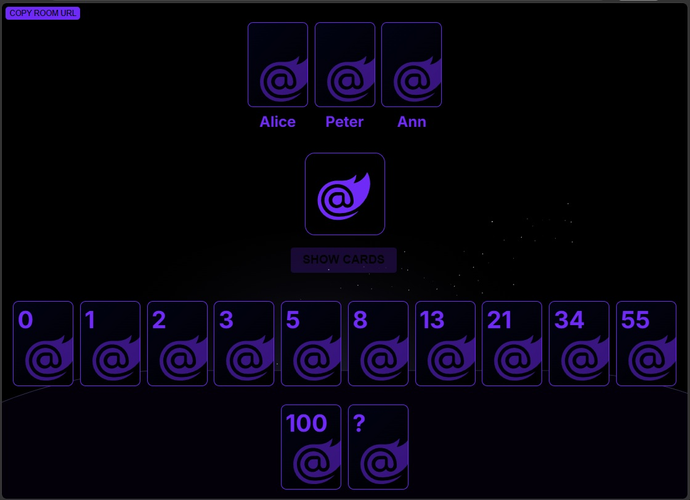

# Farukaf Poker Planning

**Didn't read? Use it now:** [poker.farukaf.com](https://poker.farukaf.com)

Run a planning-poker session with your team in the browser. Create a room, share its link, and estimate a story together without installing a client or asking everyone to create an account.



## How a round works

1. Enter a display name and create a room.
2. Share the room link with the people estimating the work.
3. Each participant privately selects a card from the room's estimation scale.
4. Reveal the cards together, compare the estimates, and start another round.

The default cards use a Fibonacci-style scale with `?` for an estimate that needs discussion. A room can use a customized set of card values.

## Run with Docker

```sh
docker run --rm -p 8080:8080 farukaf/poker-planning:latest
```

Open [http://localhost:8080](http://localhost:8080), enter a name, create a room, and send its URL to your team.

## Project

Poker Planning is built with Blazor Server on ASP.NET Core. It has no external database: room and round state live in the running process, and inactive rooms are periodically cleaned up. Restarting the container clears its active rooms.

- [Source code and issues](https://github.com/farukaf/farukaf-poker-planning)
- [Docker Hub image and tags](https://hub.docker.com/r/farukaf/poker-planning)
